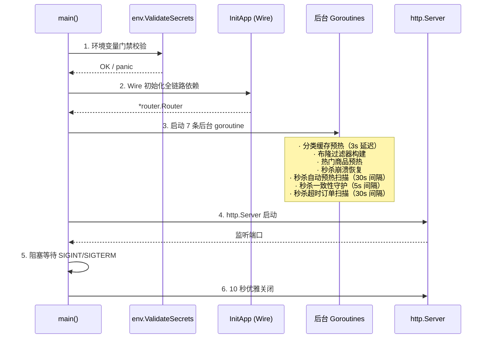

# 01 — 代码架构设计

> **难度**：⭐⭐ &emsp; **建议阅读时间**：45 分钟  
> **前置知识**：Go 基础语法、了解 MVC 分层概念  
> **下一篇**：[02-cache-design.md](./02-cache-design.md) — 缓存体系设计与全场景故障处理

---

## 📋 目录

- [1.1 项目概览与目录结构](#11-项目概览与目录结构)
- [1.2 三层架构职责边界](#12-三层架构职责边界)
- [1.3 Google Wire 编译时依赖注入](#13-google-wire-编译时依赖注入)
- [1.4 模型分层：Entity / DTO / VO](#14-模型分层entity--dto--vo)
- [1.5 中间件链顺序](#15-中间件链顺序)
- [1.6 错误处理链](#16-错误处理链)
- [1.7 配置管理](#17-配置管理)
- [1.8 路由组织](#18-路由组织)
- [1.9 项目启动流程](#19-项目启动流程)

---

## 1.1 项目概览与目录结构

### 技术栈

| 组件 | 版本 | 用途 |
|------|------|------|
| Go | 1.25 | 编程语言 |
| Gin | v1.12 | HTTP 框架（路由、中间件、参数绑定） |
| GORM | v1.31 | ORM 框架（数据库操作、迁移、事务） |
| MySQL | 8.0 | 关系型数据库 |
| Redis | 7.x | 缓存、分布式锁、Lua 脚本 |
| Google Wire | latest | 编译时依赖注入 |
| Viper | latest | 多环境配置管理 |
| JWT | v5 | 无状态身份认证 |

### 目录结构

```
backend/
├── cmd/server/                 # 应用入口
│   ├── main.go                 #   启动流程、后台任务编排、优雅关闭
│   ├── wire.go                 #   Wire 注入声明（//go:build wireinject）
│   └── wire_gen.go             #   Wire 自动生成的初始化代码
│
├── configs/                    # 多环境配置文件
│   ├── dev.yaml.example        #   本地开发模板（真实 dev.yaml 被 gitignore）
│   ├── docker.yaml             #   Docker Compose 环境
│   ├── prod.yaml               #   生产环境
│   └── test.yaml               #   测试环境
│
├── internal/                   # 私有应用代码
│   ├── config/                 #   配置结构体定义 + Viper 加载
│   ├── model/                  #   数据模型
│   │   ├── entity/             #     GORM 数据库实体
│   │   ├── dto/request/        #     入参 DTO（binding 标签校验）
│   │   └── dto/response/       #     出参 DTO（json 序列化）
│   ├── controller/             #   HTTP 控制器（薄层，参数绑定+调用 Service）
│   ├── service/                #   业务逻辑层（厚层，编排 Repository 和 Cache）
│   ├── repository/             #   数据访问层
│   │   ├── mysql/              #     GORM 数据库仓储
│   │   └── redis/              #     Redis 缓存仓储
│   ├── middleware/              #   Gin 中间件
│   ├── router/                 #   路由注册 + 中间件链组装
│   └── pkg/                    #   内部共享包
│       ├── bloom/              #     布隆过滤器
│       ├── breaker/            #     熔断器（三态状态机）
│       ├── captcha/            #     图形验证码
│       ├── env/                #     环境变量门禁
│       ├── errors/             #     自定义错误类型 + 错误码
│       ├── flashinventory/     #     秒杀本地内存库存
│       ├── flashlimiter/       #     秒杀 per-user 限流器
│       ├── jwt/                #     JWT 生成/解析 + Redis 黑名单
│       ├── keywords/           #     搜索关键词自动生成
│       ├── localcache/         #     L1 本地内存缓存（TTL + LRU）
│       ├── logger/             #     GORM 慢查询日志插件
│       ├── response/           #     统一响应格式
│       └── semaphore/          #     数据库并发信号量
│
├── docs/                       # API 文档 + 架构文档
├── logs/                       # 运行日志输出
├── uploads/                    # 用户上传文件
├── init.sql                    # 数据库建表 + 种子数据
├── Dockerfile                  # 多阶段构建（golang→alpine）
└── docker-compose.yml          # 三服务编排（backend + mysql + redis）
```

---

## 1.2 三层架构职责边界

本项目严格遵循 **Controller → Service → Repository/Cache** 三层架构，每层有明确的职责边界和依赖方向：

```
┌─────────────────────────────────────────────┐
│                  HTTP Request                │
└──────────────────┬──────────────────────────┘
                   │
┌──────────────────▼──────────────────────────┐
│          Middleware Chain（中间件链）          │
│  Trace → Logger → Cors → Recovery →          │
│  RateLimiter → Auth → AdminAuth              │
└──────────────────┬──────────────────────────┘
                   │
┌──────────────────▼──────────────────────────┐
│         Controller（控制器 — 薄层）            │
│  职责：参数绑定 + 调用 Service + 统一响应       │
│  禁止：任何业务逻辑                            │
└──────────────────┬──────────────────────────┘
                   │
┌──────────────────▼──────────────────────────┐
│          Service（服务 — 厚层）                │
│  职责：全部业务逻辑 + 编排 Repository/Cache     │
│  依赖：注入的接口，不依赖具体实现               │
└──────┬────────────────────┬─────────────────┘
       │                    │
┌──────▼──────────┐  ┌──────▼──────────────────┐
│  Repository      │  │  Cache                   │
│  (MySQL 持久化)   │  │  (Redis + 本地内存)       │
│  职责：CRUD + 事务│  │  职责：快速读写 + 降级     │
└─────────────────┘  └─────────────────────────┘
```

### 三层对比

| 维度 | Controller | Service | Repository/Cache |
|------|-----------|---------|-----------------|
| **输入** | Gin Context + 请求参数 | 业务参数/DTO | 查询条件/实体 |
| **输出** | JSON 响应（通过 response 包） | 业务结果/DTO | 实体/错误 |
| **不应包含** | 业务判断、if-else 分支 | SQL 拼接、Redis 命令 | 业务逻辑 |
| **典型行数** | 20-80 行 | 100-400 行 | 50-200 行 |

### Controller 示例：典型的薄控制器

以商品列表接口为例（`internal/controller/product/product_controller.go`）：

```go
// GetProductList 商品列表（含搜索+筛选+分页）
func (ctrl *ProductController) GetProductList(ctx *gin.Context) {
    var req request.ProductListRequest
    // 1. 参数绑定（Gin 自动校验 binding 标签）
    if err := ctx.ShouldBindQuery(&req); err != nil {
        response.Error(ctx, errors.NewParamError(err.Error()))
        return
    }
    // 2. 调用 Service（不包含任何业务逻辑）
    products, total, err := ctrl.Service.ListProducts(&req)
    if err != nil {
        response.Error(ctx, err)
        return
    }
    // 3. 统一响应
    response.Success(ctx, response.NewPageResponse(products, total, req.Page, req.PageSize))
}
```

### Service 示例：完整的调用链编排

以 `GetProductByID` 方法为例（`internal/service/product/product_service.go`），展示 Service 层如何编排多个组件：

```text
请求进入
  │
  ├─ 1. 布隆过滤器判定（bloom.MightContain）
  │     └─ 返回 false → 数据一定不存在，直接返回 404
  │
  ├─ 2. L1 本地内存缓存读取（localcache.Get）
  │     └─ 命中 → 返回，耗时 ~50ns
  │
  ├─ 3. L2 Redis 缓存读取（productCache.GetProduct）
  │     ├─ 命中 → 自动续期 + 回写 L1 → 返回，耗时 ~0.5ms
  │     ├─ 空值缓存（"nil"）→ 返回 404
  │     └─ 未命中 → 进入 DB 查询
  │
  ├─ 4. 防击穿锁（productCache.TryLockProduct SETNX）
  │     ├─ 获取成功 → 查 DB
  │     └─ 获取失败 → WaitAndRetry 轮询重试
  │
  ├─ 5. 熔断器检查（breaker.Allow）
  │     └─ 熔断中 → 直接返回错误
  │
  ├─ 6. 信号量获取（semaphore.Acquire）
  │     └─ 超时 → 返回错误
  │
  ├─ 7. 数据库查询（productRepo.GetByID）
  │     ├─ 找到 → 回写缓存 + RecordSuccess
  │     └─ 未找到 → 写空值缓存 + 返回 404
  │
  └─ 8. 释放信号量（semaphore.Release）
```

---

## 1.3 Google Wire 编译时依赖注入

### 为什么选 Wire

| 方案 | 类型 | 优点 | 缺点 |
|------|------|------|------|
| **Google Wire** | 编译时生成 | 零运行时开销、类型安全、失败在编译期暴露 | 需要写 Provider Set |
| Uber Dig | 运行时反射 | 使用简单 | 运行时错误、性能开销 |
| 手动注入 | 手写 | 最透明 | 对象多时 main.go 膨胀 |

本项目有 **7 个数据库 Repository + 3 个 Redis Cache + 7 个 Service + 8 个 Controller**，手动初始化极其繁琐，选择 Wire 可以在不牺牲性能的前提下保持代码整洁。

### 三文件协作

```
wire.go (声明)           wire_gen.go (生成)          main.go (调用)
─────────────           ─────────────────           ─────────────
ProviderSet 定义    →   wire 工具自动生成    →      InitApp() 获取
依赖关系图              具体构造函数调用链            完整对象图
```

**声明文件** `cmd/server/wire.go`：

```go
//go:build wireinject

func InitApp() (*router.Router, error) {
    wire.Build(
        // 配置
        config.Load,
        // 数据库 + 缓存
        mysql.InitDB, redis.InitRedis,
        // Repository 集合
        mysql.RepositorySet, redis.CacheSet,
        // Service 集合
        service.Set,
        // Controller 集合
        controller.Set,
        // 共享组件
        jwt.NewJWTUtil, jwt.NewRedisBlacklist,
        bloom.NewFilter, localcache.NewDefault,
        breaker.NewDefault, semaphore.NewDefault,
        // 路由
        router.NewRouter,
    )
    return nil, nil
}
```

**生成文件** `cmd/server/wire_gen.go`（自动生成，切勿手动编辑）：

```go
//go:build !wireinject

func InitApp() (*router.Router, error) {
    appConfig := config.Load()
    db := mysql.InitDB(appConfig)
    // ... 30+ 行具体的构造函数调用链 ...
    routerInstance := router.NewRouter(/* 全部依赖 */)
    return routerInstance, nil
}
```

### 注入拓扑图

```text
config.Load ─────────────────────────────────────────────────────┐
    │                                                            │
    ├── mysql.InitDB ──┬── userRepo ─── userService ─── userCtrl │
    │                  ├── productRepo ─ productService ─ prdCtrl│
    │                  ├── cartRepo ──── cartService ─── cartCtrl │
    │                  ├── orderRepo ─── orderService ── ordCtrl │
    │                  ├── orderItemRepo ──┬── paymentService     │
    │                  ├── categoryRepo ─ categorySvc ── catCtrl │
    │                  └── flashRepo ──── flashService ── flsCtrl│
    │                                                         │
    ├── redis.InitRedis ├── productCache ──────────────────────┘│
    │                   ├── categoryCache                        │
    │                   └── flashCache                           │
    │                                                            │
    ├── jwt.NewJWTUtil ────────────────────────────────────────┐│
    ├── jwt.NewRedisBlacklist ─────────────────────────────────┤│
    ├── bloom.NewFilter ───────────────────────────────────────┤│
    ├── localcache.NewDefault ─────────────────────────────────┤│
    ├── breaker.NewDefault ────────────────────────────────────┤│
    └── semaphore.NewDefault ──────────────────────────────────┘│
                                                                 │
    └──────────────── router.NewRouter ◄─────────────────────────┘
```

### 注意事项

- 每个 Provider 函数（`NewXxx`）必须导出（大写开头）
- 同一类型（如 `*gorm.DB`）多处使用时，Wire 通过参数名自动匹配
- 修改 `wire.go` 后需运行 `wire` 命令重新生成 `wire_gen.go`

---

## 1.4 模型分层：Entity / DTO / VO

### 分层定义

```text
┌──────────────────────────────────────────────┐
│                  API 边界                     │
│                                              │
│  Request DTO          Response DTO           │
│  (binding 标签)        (json 标签)             │
│  入参校验              出参序列化               │
└──────────┬───────────────────┬───────────────┘
           │                   │
           │   转换函数（Service 层）  │
           │                   │
┌──────────▼───────────────────▼───────────────┐
│              Entity（数据库实体）               │
│  GORM 标签、软删除、关联外键、乐观锁版本号        │
│  禁止暴露到 API 层                             │
└──────────────────────────────────────────────┘
```

### Entity 示例

[`internal/model/entity/product.go`](../internal/model/entity/product.go)：

```go
type Product struct {
    gorm.Model                                              // ID, CreatedAt, UpdatedAt, DeletedAt
    CategoryID uint      `gorm:"index;not null"`
    Name       string    `gorm:"size:200;not null"`
    Keywords   string    `gorm:"size:500"`                  // 自动生成搜索关键词
    Price      float64   `gorm:"type:decimal(10,2);not null"`
    Stock      int       `gorm:"not null;default:0"`
    Image      string    `gorm:"size:500"`
    Status     int       `gorm:"default:1"`
    Version    int       `gorm:"default:0" json:"-"`        // 乐观锁（不序列化到前端）
    Sales      int       `gorm:"default:0"`
}
```

关键设计点：
- `gorm.Model` 嵌入提供 `ID`、`CreatedAt`、`UpdatedAt`、`DeletedAt`（软删除）
- `Version` 字段标记 `json:"-"`，前端不可见，仅用于乐观锁
- `Keywords` 存储逗号分隔的搜索别名，由 [`internal/pkg/keywords/generator.go`](../internal/pkg/keywords/generator.go) 自动生成

### Request DTO 示例

[`internal/model/dto/request/product_request.go`](../internal/model/dto/request/product_request.go)：

```go
type CreateProductRequest struct {
    CategoryID uint    `json:"category_id" binding:"required" msg:"分类ID不能为空"`
    Name       string  `json:"name" binding:"required" msg:"商品名称不能为空"`
    Price      float64 `json:"price" binding:"required,gt=0" msg:"价格必须大于0"`
    Stock      int     `json:"stock" binding:"required,gte=0" msg:"库存不能为负"`
    Image      string  `json:"image"`
    Keywords   string  `json:"keywords"` // 留空则自动生成
}
```

- `binding` 标签由 Gin 自动校验，校验失败时 `ShouldBindJSON` 返回错误
- `msg` 标签用于中文错误提示
- **⚠️ 常见陷阱**：`Status` 等有 0 值语义的 int 字段必须定义为 `*int` 指针类型，否则 Gin 的 `required` 标签把 `0` 判为"未提供"

### Response DTO 示例

[`internal/model/dto/response/product_response.go`](../internal/model/dto/response/product_response.go)：

```go
type ProductResponse struct {
    ID         uint   `json:"id"`
    CategoryID uint   `json:"category_id"`
    Name       string `json:"name"`
    Price      string `json:"price"`       // 格式化为字符串，避免浮点精度问题
    Stock      int    `json:"stock"`
    Image      string `json:"image"`
    Status     int    `json:"status"`
    CreatedAt  string `json:"created_at"`  // 时间格式化为字符串
}
```

### 转换函数

Entity ↔ DTO 的转换在 Service 层完成，不在 Controller 或 Repository 中：

```go
// internal/service/product/product_service.go
func convertToProductResponse(product *entity.Product) *response.ProductResponse {
    return &response.ProductResponse{
        ID:         product.ID,
        Name:       product.Name,
        Price:      fmt.Sprintf("%.2f", product.Price),
        Stock:      product.Stock,
        CreatedAt:  product.CreatedAt.Format("2006-01-02 15:04:05"),
    }
}
```

---

## 1.5 中间件链顺序

中间件的注册顺序决定执行顺序——**先注册的先执行**。本项目在 [`internal/router/router.go`](../internal/router/router.go#L89-L99) 中按以下顺序注册：

```
        请求进入
          │
    ┌─────▼─────────────────────────────────────┐
    │ 1. gin.Logger()                            │  Gin 内置请求日志
    └─────┬─────────────────────────────────────┘
          │
    ┌─────▼─────────────────────────────────────┐
    │ 2. Trace()                                 │  注入唯一 Request ID
    │    · 复用 X-Request-ID 头（跨服务传播）       │
    │    · 无头时生成 16 位 hex 随机 ID            │
    │    · 写入 Gin Context + context.Context     │
    │    · 设置响应头 X-Request-ID                │
    └─────┬─────────────────────────────────────┘
          │
    ┌─────▼─────────────────────────────────────┐
    │ 3. Cors()                                  │  跨域资源共享
    │    · 允许所有来源                           │
    │    · Authorization 头白名单                │
    │    · 预检请求缓存 12h                       │
    └─────┬─────────────────────────────────────┘
          │
    ┌─────▼─────────────────────────────────────┐
    │ 4. CustomRecovery()                        │  Panic 恢复（增强版）
    │    · 捕获 panic                            │
    │    · 打印完整堆栈 debug.Stack()             │
    │    · 返回统一错误 JSON                      │
    │    · 防止已写入响应后重复写                  │
    └─────┬─────────────────────────────────────┘
          │
    ┌─────▼─────────────────────────────────────┐
    │ 5. RateLimiter（IP 令牌桶）                 │  IP 级全局限流
    │    · 200 令牌/秒，突发 300                  │
    │    · 5 分钟清理不活跃 IP                    │
    └─────┬─────────────────────────────────────┘
          │
    ┌─────▼─────────────────────────────────────┐
    │ 6. Auth() [路由组级别]                      │  需登录接口
    │    · 解析 Bearer Token                    │
    │    · 检查 JTI 黑名单（Redis）               │
    │    · 注入 user_id/role_id/username 到 ctx  │
    └─────┬─────────────────────────────────────┘
          │
    ┌─────▼─────────────────────────────────────┐
    │ 7. AdminAuth() [路由组级别]                 │  管理员接口
    │    · 继承 Auth() 全部校验                   │
    │    · 额外检查 role_id == 1                 │
    └───────────────────────────────────────────┘
```

### 为什么 Trace 最早、Auth 最晚

- **Trace 最早**：Request ID 必须在任何日志输出前注入，GORM 慢查询日志通过 `context.Context` 传递 Request ID 实现 SQL ↔ HTTP 请求的关联追踪
- **Auth 最晚**：认证前需要前面所有安全防护（恢复、限流）已就绪，防止恶意请求绕过

### 关键实现

**Trace 中间件**（[`internal/middleware/trace.go`](../internal/middleware/trace.go)）：将 Request ID 同时注入 Gin Context（`c.Set`）和 Go Context（`context.WithValue`），后者供 GORM Logger 提取做链路追踪。

**CustomRecovery**（[`internal/router/router.go`](../internal/router/router.go#L206-L228)）：比 Gin 内置 Recovery 多出完整堆栈打印和"已写入检查"（`c.Writer.Written()`），防止重复写响应头导致 panic。

**RateLimiter**（[`internal/middleware/ratelimit.go`](../internal/middleware/ratelimit.go)）：基于令牌桶算法，按 `c.ClientIP()` 分桶，后台 goroutine 每 5 分钟清理不活跃 IP 防止内存泄漏。

**Auth 中间件**（[`internal/middleware/auth.go`](../internal/middleware/auth.go)）：JWT 解析后通过 JTI（JWT Unique ID）查询 Redis 黑名单，支持主动踢人下线（用户修改密码后旧 Token 立即失效）。

---

## 1.6 错误处理链

自定义错误系统由三个组件协作完成，贯穿三层架构：

```text
Repository 层          Service 层           Controller 层
──────────────        ────────────         ──────────────
errors.Wrap()    →   errors.IsCode()  →   response.Error()
包装原始错误          判断业务错误码          统一 JSON 响应
```

### 自定义错误类型

[`internal/pkg/errors/errors.go`](../internal/pkg/errors/errors.go)：

```go
type Error struct {
    Code    int    `json:"code"`     // 业务错误码
    Message string `json:"message"`  // 用户可读描述
    Err     error  `json:"-"`        // 原始错误（json:"-" 防止泄露到前端）
}
```

**设计要点**：
- 原始 `Err` 标记 `json:"-"` —— 即使序列化该结构体，底层实现细节也不会泄露
- HTTP 状态码始终返回 `200`，业务状态通过 JSON `code` 字段区分
- 错误码按模块分段：`1001-1013` 为通用业务，`2001-2009` 为秒杀业务

### 三层使用规范

| 层 | 方法 | 示例 | 注意 |
|-----|------|------|------|
| **Repository** | `errors.Wrap(err, "描述")` | `errors.Wrap(err, "查询商品失败")` | 包装 `gorm.ErrRecordNotFound` 为 `CodeNotFound` |
| **Service** | `errors.IsCode(err, code)` | `if errors.IsCode(err, errors.CodeNotFound)` | **禁止** `err == gorm.ErrRecordNotFound` 直接比较 |
| **Controller** | `response.Error(c, err)` | 统一入口，自动判断错误类型 | 无需手动区分错误码 |

### ⚠️ 常见陷阱

Repository 层已经把 `gorm.ErrRecordNotFound` 包装成了 `*errors.Error{Code: CodeNotFound}`。Service 层**必须**使用 `errors.IsCode(err, code)` 做类型断言，**禁止**用 `err == gorm.ErrRecordNotFound` 直接比较。

### 统一响应格式

[`internal/pkg/response/response.go`](../internal/pkg/response/response.go)：

```go
type Response struct {
    Code    int         `json:"code"`
    Message string      `json:"message"`
    Data    interface{} `json:"data,omitempty"`
}

// Success 成功响应
func Success(ctx *gin.Context, data interface{}) {
    ctx.JSON(http.StatusOK, Response{Code: 0, Message: "success", Data: data})
}

// Error 错误响应 — 自动判断错误类型
func Error(ctx *gin.Context, err error) {
    if e, ok := err.(*errors.Error); ok {
        ctx.JSON(http.StatusOK, Response{Code: e.Code, Message: e.Message})
        return
    }
    // gorm.ErrRecordNotFound 特殊处理
    if errors.Is(err, gorm.ErrRecordNotFound) {
        ctx.JSON(http.StatusOK, Response{Code: errors.CodeNotFound, Message: "资源不存在"})
        return
    }
    // 其他错误兜底
    ctx.JSON(http.StatusOK, Response{Code: errors.CodeServerError, Message: "服务器内部错误"})
}
```

---

## 1.7 配置管理

### 配置加载流程

[`internal/config/config.go`](../internal/config/config.go#L76-L110)：

```text
1. 读取 GO_ENV 环境变量（默认 "dev"）
        │
2. 加载 configs/{GO_ENV}.yaml
        │
3. viper.AutomaticEnv() — 环境变量覆盖 YAML 值
   MYSQL_PASSWORD 覆盖 mysql.password
   REDIS_HOST     覆盖 redis.host
        │
4. 反序列化为 AppConfig 结构体
```

### 多环境配置

| 环境 | GO_ENV 值 | 配置文件 | 敏感信息来源 |
|------|-----------|----------|-------------|
| 本地开发 | `dev`（默认） | `configs/dev.yaml`（gitignore） | 本机环境变量 |
| Docker | `docker` | `configs/docker.yaml` | `docker-compose.yml` 中 env 段 |
| 生产 | `prod` | `configs/prod.yaml` | K8s Secrets / Vault |
| 测试 | `test` | `configs/test.yaml` | 环境变量 |

### 敏感信息门禁

[`internal/pkg/env/validator.go`](../internal/pkg/env/validator.go) 在 `main.go` 第一步执行，比配置加载还早：

- **生产/Docker 模式**：缺任何必需环境变量 → `panic` 阻止启动（fail-fast）
- **开发模式**：缺变量 → 打印 warning 日志，不阻塞启动
- **弱密码检测**：JWT Secret 长度 < 16 或包含 `your-secret`/`change-me`/`test`/`123456` → 告警

### 配置结构体

```go
type AppConfig struct {
    Server    ServerConfig    // 端口、运行模式
    MySQL     MySQLConfig     // 主机、端口、用户名、密码（env）、数据库名
    Redis     RedisConfig     // 主机、端口、密码
    JWT       JWTConfig       // 密钥（env）、过期小时数
    Alipay    AlipayConfig    // 应用ID、密钥
    Cache     CacheConfig     // 热门商品预热数量
    FlashSale FlashSaleConfig // 支付超时、冷却时间、随机延迟上限
}
```

---

## 1.8 路由组织

[`internal/router/router.go`](../internal/router/router.go#L113-L200) 将路由按权限分为三组：

### 路由分组总览

```text
/health                     → 健康检查（全局）
/swagger/*any               → API 文档（全局）
/uploads                    → 静态文件（全局）

/api/v1/                    → public 组（无需登录）
  ├── /user/register           注册
  ├── /user/login              登录
  ├── /user/forgot-password    忘记密码
  ├── /product/list            商品列表（搜索+筛选+分页）
  ├── /product/:id             商品详情
  ├── /product/category/*      分类查询
  ├── /flash/list              秒杀活动列表
  ├── /flash/:id               秒杀详情
  └── /alipay/*                支付宝回调

/api/v1/auth/               → auth 组（需 JWT 登录）
  ├── /user/info               用户信息（GET/PUT）
  ├── /cart/*                  购物车 CRUD
  ├── /order/*                 订单创建/列表/支付/删除
  └── /flash/*                 验证码/排队入场/抢购/订单查询

/api/v1/admin/              → admin 组（需管理员 role_id=1）
  ├── /product                 商品管理 CRUD
  ├── /category/*              分类管理 CRUD
  ├── /upload                  文件上传
  ├── /product/batch-keywords  批量生成关键词
  ├── /user/*                  用户管理（列表/状态/重置密码/删除）
  ├── /verify-pin              验证管理员 PIN
  ├── /set-pin                 设置管理员 PIN
  └── /flash/*                 秒杀活动管理
```

### 路由注册方式

```go
// 公开组 — 无中间件
public := engine.Group("/api/v1")
public.POST("/user/register", r.UserController.Register)

// 需登录组 — Auth 中间件
auth := engine.Group("/api/v1/auth")
auth.Use(middleware.Auth(r.JWTUtil, r.TokenBlacklist))
auth.POST("/cart/add", r.CartController.AddToCart)

// 管理员组 — Auth + AdminAuth 中间件
admin := engine.Group("/api/v1/admin")
admin.Use(middleware.Auth(r.JWTUtil, r.TokenBlacklist))
admin.Use(middleware.AdminAuth())
admin.POST("/product", r.AdminController.CreateProduct)
```

---

## 1.9 项目启动流程

[`cmd/server/main.go`](../cmd/server/main.go) 按以下时序完成启动：



### 关键设计点

- **后台任务不阻塞启动**：每个 goroutine 有独立的 panic 恢复（`defer/recover`），一个挂掉不影响其他
- **延迟启动**：缓存预热延迟 3 秒等 DB/Redis 连接就绪；秒杀自动预热延迟 5 秒等首次预热完成
- **优雅关闭**：收到终止信号后，`http.Server.Shutdown` 等待 10 秒排空进行中的请求，超时强制退出
- **布隆过滤器定时重建**：每小时全量重建（[main.go L117-L132](../cmd/server/main.go)），清理已删除 ID 的误判积累

---

## 📋 本章小结

| 概念 | 核心要点 |
|------|---------|
| 三层架构 | Controller 薄（参数绑定）→ Service 厚（业务编排）→ Repository 接口化（数据访问） |
| 依赖注入 | Google Wire 编译时生成，零运行时开销 |
| 模型分层 | Entity（DB 映射）→ Request DTO（入参校验）→ Response DTO（出参序列化） |
| 中间件链 | Trace → Logger → Cors → Recovery → RateLimiter → Auth → AdminAuth |
| 错误处理 | Repository 包装 → Service 判断错误码 → Controller 统一响应 |
| 配置管理 | Viper 多环境 + 环境变量覆盖 + 启动门禁校验 |

---

> **下一篇**：[02-cache-design.md](./02-cache-design.md) — 深入缓存体系设计，包括穿透/击穿/雪崩的全场景防护方案
