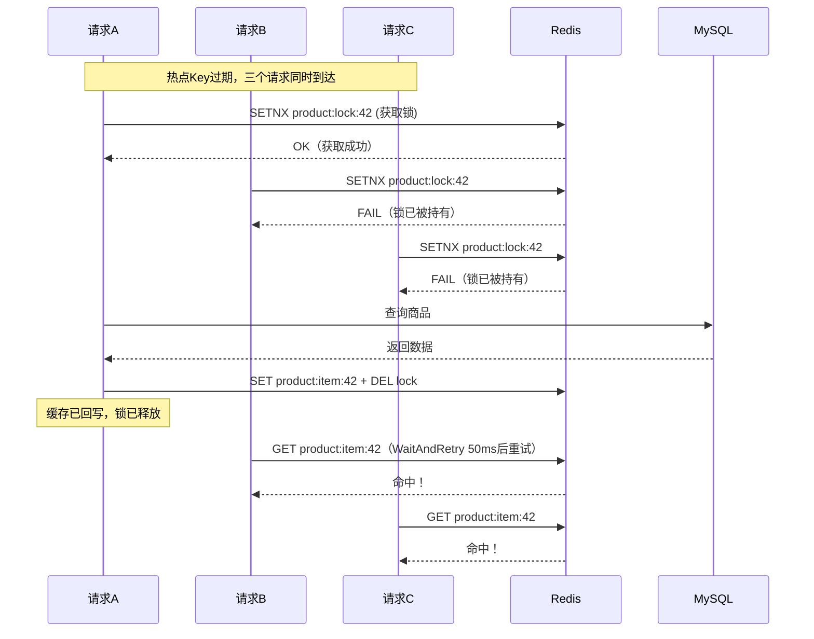

# 02 — 缓存体系设计与全场景故障处理

> **难度**：⭐⭐⭐ &emsp; **建议阅读时间**：90 分钟  
> **前置知识**：Redis 基础命令（GET/SET/SETNX/Lua）、已阅读 [01-architecture.md](./01-architecture.md)  
> **下一篇**：[03-database-design.md](./03-database-design.md) — 数据库设计与全场景故障处理

---

## 📋 目录

- [2.1 缓存架构总览](#21-缓存架构总览)
- [2.2 缓存穿透 — 三层递进防护](#22-缓存穿透--三层递进防护)
- [2.3 缓存击穿 — 分布式互斥锁](#23-缓存击穿--分布式互斥锁)
- [2.4 缓存雪崩 — 三层协同防护](#24-缓存雪崩--三层协同防护)
- [2.5 缓存一致性策略](#25-缓存一致性策略)
- [2.6 热点数据自动续期](#26-热点数据自动续期)
- [2.7 缓存预热机制](#27-缓存预热机制)
- [2.8 缓存降级策略](#28-缓存降级策略)
- [2.9 故障处理速查表](#29-故障处理速查表)
- [2.10 面试核心问答](#210-面试核心问答)

---

## 2.1 缓存架构总览

### 两级缓存架构

本项目采用 **L1 本地内存 + L2 Redis** 两级缓存架构：

```text
                   HTTP Request
                        │
            ┌───────────▼───────────┐
            │  L1 本地内存缓存        │  命中延迟 ~50ns
            │  (localcache)          │  容量：10,000 条目
            │  TTL + LRU 淘汰        │  命中率：~60%
            └───────────┬───────────┘
                        │ 未命中
            ┌───────────▼───────────┐
            │  L2 Redis 缓存         │  命中延迟 ~0.5ms
            │  (product_cache)       │  容量：由 Redis 内存决定
            │  TTL + 自动续期         │  命中率：~35%
            └───────────┬───────────┘
                        │ 未命中
            ┌───────────▼───────────┐
            │  MySQL 数据库          │  查询延迟 ~1-10ms
            │  (product_repository)  │  带熔断器 + 信号量保护
            └───────────────────────┘
```

### 性能对比

| 缓存层 | 存储介质 | 典型延迟 | 与下一层差距 | 适用场景 |
|--------|---------|---------|-------------|---------|
| L1 本地内存 | 进程堆内存 | ~50ns | 10,000× | 热点商品详情、秒杀库存标记 |
| L2 Redis | 远程内存 | ~0.5ms | 2-20× | 全量商品、分类树、列表缓存 |
| MySQL | 磁盘 | ~1-10ms | 基准 | 持久化存储、复杂查询 |

### 缓存 Key 命名规范

| Key 模式 | 示例 | 说明 |
|----------|------|------|
| `product:item:{id}` | `product:item:42` | 单品缓存 |
| `product:list:{kw}:{cat}` | `product:list:手机:3` | 列表缓存（按搜索词+分类） |
| `product:lock:{id}` | `product:lock:42` | 分布式互斥锁 |
| `category:parents` | — | 父级分类列表 |
| `category:children:{pid}` | `category:children:0` | 子级分类列表 |
| `flash:stock:{id}` | `flash:stock:7` | 秒杀库存 |
| `flash:user:{id}` | `flash:user:7` | 秒杀已购用户集合 |
| `flash:pending:{id}` | `flash:pending:7` | 秒杀防丢失记录 |
| `jwt:blacklist:{jti}` | `jwt:blacklist:a1b2c3` | JWT 黑名单 |

### 连接池配置

[`internal/repository/redis/redis.go`](../internal/repository/redis/redis.go)：

| 参数 | 值 | 说明 |
|------|-----|------|
| PoolSize | 20 | 最大连接数 |
| MinIdleConns | 5 | 最小空闲连接 |
| DialTimeout | 5s | 连接超时 |
| ReadTimeout | 3s | 读超时 |
| WriteTimeout | 3s | 写超时 |
| IdleTimeout | 5min | 空闲连接超时 |

---

## 2.2 缓存穿透 — 三层递进防护

### 问题定义

**缓存穿透（Cache Penetration）**：大量查询**不存在**的数据，每次查询都穿过缓存直达数据库。攻击者可构造大量不存在的 ID 发起请求，耗尽数据库连接。

```
恶意请求: GET /product/99999999  (ID 不存在)
  → L1 缓存: 未命中
  → L2 Redis: 未命中
  → MySQL: 查询 → 返回空
  → 不写入缓存（错误做法）
  → 下一个请求再次穿透...
```

### 三层防护架构

```text
请求进入（product ID）
        │
┌───────▼───────────────────────────────────┐
│  第一层：布隆过滤器（Bloom Filter）           │
│  概率型判否 — "一定不存在"直接返回 404         │
│  误判率：0.1%（万分之一会穿透）               │
│  内存占用：~14.4 MB / 100万元素              │
└───────┬───────────────────────────────────┘
        │ 可能存在
┌───────▼───────────────────────────────────┐
│  第二层：空值缓存（Null Value Cache）         │
│  缓存 "nil" 标记，TTL = 1 分钟              │
│  拦截布隆过滤器的误判 + 无布隆的查询           │
└───────┬───────────────────────────────────┘
        │ 未命中
┌───────▼───────────────────────────────────┐
│  第三层：数据库兜底                          │
│  查 DB 确认不存在 → 写空值缓存 → 返回 404     │
└───────────────────────────────────────────┘
```

### 第一层：布隆过滤器

[`internal/pkg/bloom/bloom.go`](../internal/pkg/bloom/bloom.go) 使用 FNV-64a 双哈希技术实现：

| 参数 | 值 | 计算依据 |
|------|-----|---------|
| 预期元素数（n） | 1,000,000 | 产品总量估计 |
| 目标误判率（p） | 0.1% | 万分之一 |
| 位数组大小（m） | ~11,500,000 位 ≈ 14.4 MB | `m = -n·ln(p) / (ln(2))²` |
| 哈希函数数（k） | 7 | `k = (m/n)·ln(2)` |

```go
// MightContain 判断元素是否"可能存在"
// 返回 false → 一定不存在 → 直接返回 404
// 返回 true  → 可能存在 → 继续查缓存/DB
func (f *Filter) MightContain(data []byte) bool {
    f.mu.RLock()
    defer f.mu.RUnlock()
    for i, h := range f.hashFuncs {
        h.Reset()
        h.Write(f.seeds[i])
        h.Write(data)
        hashVal := h.Sum64()
        bitIndex := hashVal % f.size
        wordIndex := bitIndex / 64
        bitOffset := bitIndex % 64
        // 只要有一个位为 0，元素一定不存在
        if f.bits[wordIndex]&(1<<bitOffset) == 0 {
            return false
        }
    }
    return true // 所有位都为 1，元素可能存在
}
```

**生命周期管理**（[`cmd/server/main.go`](../cmd/server/main.go)）：
- **启动时**：全量加载所有产品 ID 构建（延迟 3 秒等 DB 就绪）
- **运行时**：新增产品时实时 `Add`（[`product_service.go`](../internal/service/product/product_service.go)）
- **定时重建**：每小时全量重建一次，清理已删除 ID 的误判积累

**在 Service 层的应用**（[`internal/service/product/product_service.go`](../internal/service/product/product_service.go)）：

```go
func (s *productService) GetProductByID(id uint) (*response.ProductResponse, error) {
    // 第一道防线：布隆过滤器
    if !s.bloom.MightContain([]byte(fmt.Sprintf("%d", id))) {
        return nil, errors.New(errors.CodeProductNotFound, "商品不存在")
    }
    // 继续走 L1 → L2 → DB 的常规流程...
}
```

### 第二层：空值缓存

当布隆过滤器误判或数据确实不存在时，将 `"nil"` 字符串存入 Redis，设置较短的 TTL（1 分钟 + 随机抖动）：

[`internal/repository/redis/product_cache.go`](../internal/repository/redis/product_cache.go)：

```go
// 读取时识别空值缓存
func (c *productCache) GetProduct(id uint) (*entity.Product, error) {
    data, err := c.rdb.Get(c.ctx, key).Result()
    if err != nil { return nil, nil } // 降级
    if data == "nil" { return nil, nil } // 空值缓存命中
    // ... 正常反序列化
}

// 写入空值缓存（DB 确认不存在后调用）
func (c *productCache) SetProduct(product *entity.Product) error {
    if product == nil {
        // 写入 "nil" 标记，TTL 1分钟 + 随机抖动
        return c.rdb.Set(c.ctx, key, "nil", nilCacheTTL()).Err()
    }
    // 正常写入...
}
```

**为什么 TTL 设为 1 分钟？**
- 太短（如 5 秒）→ 拦截效果差，大部分流量仍穿透
- 太长（如 1 小时）→ 如果数据后来被创建，前端长时间看到 404
- 1 分钟是"拦截效果"与"数据时效"的折中

### 第三层：数据库兜底

Service 层确认 DB 中不存在后，写入空值缓存（[`product_service.go`](../internal/service/product/product_service.go)）：

```go
product, err := s.productRepo.GetByID(id)
if err != nil {
    if errors.IsCode(err, errors.CodeNotFound) {
        // DB 也不存在 → 写空值缓存（异步，不影响响应）
        go func() {
            defer func() { recover() }() // panic 保护
            s.productCache.SetProduct(nil) // product == nil 触发空值写入
        }()
    }
    return nil, err
}
```

---

## 2.3 缓存击穿 — 分布式互斥锁

### 问题定义

**缓存击穿（Hotspot Invalid / Cache Breakdown）**：某个**热点 Key**（如爆款商品）在过期瞬间，大量并发请求同时涌入数据库查询同一条数据。

```
热点商品缓存过期
  │
  ├── 请求1 → 缓存未命中 → 查DB ┐
  ├── 请求2 → 缓存未命中 → 查DB  ├─ 1000个并发
  ├── 请求3 → 缓存未命中 → 查DB  │  同时打到DB
  └── ...                      ┘
```

### 解决方案：Redis SETNX 分布式互斥锁



### 实现细节

[`internal/repository/redis/product_cache.go`](../internal/repository/redis/product_cache.go)：

```go
const (
    productLockExpire       = 5 * time.Second    // 锁过期（防死锁）
    productLockRetryInterval = 50 * time.Millisecond // 重试间隔
    productLockMaxWait      = 2 * time.Second      // 最大等待时间
)

// TryLockProduct 使用 SETNX 获取分布式互斥锁
func (c *productCache) TryLockProduct(id uint) bool {
    ok, err := c.rdb.SetNX(c.ctx, lockKey, "1", productLockExpire).Result()
    if err != nil {
        // ⚠️ Redis 故障时降级放行（宁可多查一次 DB 也不能阻塞）
        return true
    }
    return ok
}

// WaitAndRetry 等待锁持有者完成 DB 查询后重试读缓存
func (c *productCache) WaitAndRetry(id uint) (*entity.Product, bool) {
    deadline := time.Now().Add(productLockMaxWait)
    for time.Now().Before(deadline) {
        time.Sleep(productLockRetryInterval)       // 等 50ms
        product, _ := c.GetProduct(id)             // 重试读缓存
        if product != nil {
            return product, true                   // 命中返回
        }
    }
    return nil, false  // 超时：调用方降级为自行查 DB
}
```

### Service 层完整调用链

```go
// 1. 先读缓存
product, _ := s.productCache.GetProduct(id)
if product != nil { return product }

// 2. 尝试获取分布式锁
if s.productCache.TryLockProduct(id) {
    // 获取成功 → 负责查 DB
    defer s.productCache.UnlockProduct(id)
    product, err = s.productRepo.GetByID(id)
    // ... 回写缓存
} else {
    // 获取失败 → 等待其他 goroutine 完成
    product, ok := s.productCache.WaitAndRetry(id)
    if ok { return product }
    // 超时 → 降级自行查 DB
    product, err = s.productRepo.GetByID(id)
}
```

### 关键设计决策

| 决策 | 值 | 理由 |
|------|-----|------|
| 锁超时 | 5 秒 | 足够完成一次 DB 查询 + 缓存回写，超时自动释放防死锁 |
| 重试间隔 | 50ms | 平衡轮询开销和响应速度 |
| 最大等待 | 2 秒 | 超过则降级自行查 DB（宁可多查一次也不能让用户等） |
| Redis 故障 | 放行 | `err != nil` 时返回 `true`，不阻塞业务 |

### 与 Singleflight 的对比

| 维度 | 本项目方案（分布式锁） | Singleflight |
|------|----------------------|-------------|
| 作用范围 | 跨进程（所有服务实例） | 单进程（当前实例内） |
| 实现方式 | Redis SETNX | `golang.org/x/sync/singleflight` |
| 适用场景 | 多副本部署 | 单实例或已有分布式缓存时辅助 |
| 复杂度 | 需管理锁超时、释放 | 零配置，标准库风格 |

---

## 2.4 缓存雪崩 — 三层协同防护

### 问题定义

**缓存雪崩（Cache Avalanche）**：**大量 Key 同时过期**，瞬时流量全部打到数据库。与击穿的区别在于**范围**——击穿是单点，雪崩是大面积。

```
同一时刻 1000 个缓存 Key 全部过期
     ↓
10000 QPS 全部穿透到 MySQL
     ↓
连接池耗尽 → 熔断 → 服务不可用
```

### 三层协同防护

```text
┌──────────────────────────────────────────────────┐
│  第一层：TTL 随机抖动（事前预防）                    │
│  · 每个 Key 的 TTL 叠加 ±20% 随机值                │
│  · 将过期时间从"同一时刻"分散到"一个区间"            │
│  · 零额外开销，每个 Key 多存一段随机偏移             │
└──────────────────┬───────────────────────────────┘
                   │ 抖动未能完全分散时
┌──────────────────▼───────────────────────────────┐
│  第二层：熔断器 CircuitBreaker（事中阻断）           │
│  · 连续 5 次 DB 错误 → OPEN（拒绝所有请求）          │
│  · 30 秒后 → HALF-OPEN（试探恢复）                  │
│  · 试探成功 → CLOSED（恢复正常）                    │
└──────────────────┬───────────────────────────────┘
                   │ 熔断器关闭时（恢复期试探）
┌──────────────────▼───────────────────────────────┐
│  第三层：信号量 Semaphore（流量整形）                │
│  · 最多 30 个 goroutine 同时查 DB                  │
│  · 超出排队等待（2 秒超时）                         │
│  · 保护 DB 连接池不会被瞬时打满                     │
└──────────────────────────────────────────────────┘
```

### 第一层：TTL 随机抖动

[`internal/repository/redis/product_cache.go`](../internal/repository/redis/product_cache.go#L39-L47)：

```go
// cacheTTLWithJitter 在基础 TTL 上叠加 ±20% 随机抖动
// 10分钟基础TTL → 实际 8~12 分钟随机分布
func cacheTTLWithJitter(base time.Duration) time.Duration {
    jitter := time.Duration(float64(base) * 0.2 * (rand.Float64()*2 - 1))
    return base + jitter
}
```

**所有缓存写入都使用此函数**——单品缓存、列表缓存、空值缓存均叠加随机抖动。关键是把**同一时刻**的集中过期转化为**一个时间窗口**内的分散过期。

### 第二层：熔断器（三态状态机）

[`internal/pkg/breaker/circuit_breaker.go`](../internal/pkg/breaker/circuit_breaker.go)：

```text
                  ┌──────────────────────┐
  请求通过 ◄──────│     CLOSED（闭合）     │
                  │  errorCount < 5       │
                  └──────┬───────────────┘
                         │ errorCount >= 5
                         ▼
                  ┌──────────────────────┐
  请求直接拒绝 ◄───│     OPEN（断开）       │
                  │  持续 30 秒           │
                  └──────┬───────────────┘
                         │ 30 秒到期
                         ▼
                  ┌──────────────────────┐
          ┌──────│  HALF-OPEN（半开）    │──────┐
          │       │  允许首个请求试探      │      │
          │       └──────────────────────┘      │
          │ 试探成功 → CLOSED           试探失败 → OPEN
```

```go
// Allow 判断当前是否允许请求通过
func (cb *CircuitBreaker) Allow() bool {
    state := State(cb.state.Load())
    switch state {
    case StateClosed:
        return true
    case StateOpen:
        // 检查是否已超过超时时间，可进入半开状态
        if time.Since(cb.openedAt) > cb.timeout {
            cb.mu.Lock()
            cb.setState(StateHalfOpen)
            cb.mu.Unlock()
            return true  // 半开状态允许试探
        }
        return false
    case StateHalfOpen:
        return true  // 半开状态允许通过（用于试探恢复）
    }
    return false
}
```

**在 Service 层的集成**（[`product_service.go`](../internal/service/product/product_service.go)）：

```go
// DB 查询前检查熔断器
if !s.breaker.Allow() {
    return nil, errors.New(errors.CodeServerError, "服务暂时不可用，请稍后重试")
}
product, err := s.productRepo.GetByID(id)
if err != nil {
    s.breaker.RecordFailure() // 记录失败
} else {
    s.breaker.RecordSuccess() // 记录成功
}
```

### 第三层：信号量限流

[`internal/pkg/semaphore/limiter.go`](../internal/pkg/semaphore/limiter.go) 使用带缓冲 channel 实现信号量：

```go
type Limiter struct {
    sem     chan struct{}    // 信号量通道
    timeout time.Duration    // 等待超时
}

func NewDefault() *Limiter {
    return New(30, 2*time.Second) // 30 并发槽位，2 秒超时
}

func (l *Limiter) Acquire(ctx context.Context) error {
    select {
    case l.sem <- struct{}{}:  // 获取槽位
        return nil
    case <-time.After(l.timeout):  // 超时
        return errors.New("数据库并发查询已满，请稍后重试")
    case <-ctx.Done():  // 请求取消
        return ctx.Err()
    }
}

func (l *Limiter) Release() {
    <-l.sem  // 释放槽位
}
```

**为什么设为 30 并发（连接池的 60%）？**
- 连接池 `MaxOpenConns=50`
- 缓存回写、事务提交等非查询操作也需要连接
- 留 20 个连接的呼吸空间，防止查询占满所有连接导致其他操作失败

---

## 2.5 缓存一致性策略

### 策略：Cache Aside（旁路缓存）

```
写操作：先更新 DB → 后删除缓存
读操作：先读缓存 → 缓存未命中则读 DB → 回写缓存
```

### 为什么是"先更新 DB 后删缓存"而非反过来？

| 顺序 | 并发场景 | 结果 |
|------|---------|------|
| **先删缓存 → 后更新 DB** | 删缓存后、更新 DB 前，另一个请求读 DB 写缓存 | 缓存中永久是旧值 |
| **先更新 DB → 后删缓存** | 更新 DB 后、删缓存前，另一个请求读缓存 | 读到旧值，但仅持续到缓存 TTL 过期 |

结论：后删缓存的脏数据窗口更短且能自愈，是更安全的选择。

### 实现

[`internal/service/product/product_service.go`](../internal/service/product/product_service.go)：

```go
func (s *productService) UpdateProduct(id uint, req *request.UpdateProductRequest) error {
    // 1. 先更新数据库
    if err := s.productRepo.Update(product); err != nil {
        return err
    }
    // 2. 删除单品缓存（保证下次读取获取新值）
    s.productCache.DeleteProduct(id)
    // 3. 清理所有列表缓存（因为商品信息变更可能影响列表展示）
    s.productCache.ClearAllProductList()
    return nil
}
```

### SCAN 分批清理（不用 KEYS）

[`internal/repository/redis/product_cache.go`](../internal/repository/redis/product_cache.go#L246-L275) 使用 `SCAN` 命令而非 `KEYS`：

```go
func (c *productCache) ClearAllProductList() error {
    pattern := "product:list:*"
    var cursor uint64
    for {
        // SCAN 每次只扫描 100 个 Key，不会阻塞 Redis
        keys, nextCursor, err := c.rdb.Scan(c.ctx, cursor, pattern, 100).Result()
        if err != nil { return err }
        if len(keys) > 0 {
            c.rdb.Del(c.ctx, keys...)  // 批量删除
        }
        cursor = nextCursor
        if cursor == 0 { break }  // 扫描完成
    }
    return nil
}
```

**KEYS vs SCAN**：

| 命令 | 阻塞特性 | 适用场景 |
|------|---------|---------|
| `KEYS product:list:*` | **阻塞** — 遍历全部 Key 期间 Redis 无法处理其他请求 | 调试、极少量 Key |
| `SCAN 0 MATCH product:list:* COUNT 100` | **非阻塞** — 分批迭代，每批之间 Redis 正常服务 | 生产环境批量操作 |

### 高级一致性方案（扩展）

对于秒杀库存等强一致场景，本项目使用了额外保障（详见 [04-cascading-failures.md](./04-cascading-failures.md)）：
- **延迟双删**：删缓存 → 更新 DB → sleep Nms → 再删缓存
- **Lua 原子操作**：Redis 库存扣减和回滚在同一 Lua 脚本中完成
- **Pending 记录**：Redis 操作成功后先写 pending 记录再写 DB，防崩溃丢失

---

## 2.6 热点数据自动续期

### 设计动机

热点商品（如秒杀爆款）被高频访问。如果按固定 TTL 过期，每次过期都会触发缓存击穿防护（分布式锁 + 查 DB），造成不必要的开销。

### 实现原理

[`internal/repository/redis/product_cache.go`](../internal/repository/redis/product_cache.go#L109-L119) 在每次 `GetProduct` 命中时检查并续期：

```go
// 热点数据自动续期
ttl, err := c.rdb.TTL(c.ctx, key).Result()
if err == nil && ttl < productMaxExpire {
    newTTL := ttl + productRenewDuration  // 延长 5 分钟
    if newTTL > productMaxExpire {
        newTTL = productMaxExpire          // 不超过 1 小时上限
    }
    c.rdb.Expire(c.ctx, key, newTTL)
}
```

### 续期参数

| 常量 | 值 | 含义 |
|------|-----|------|
| `productBaseExpire` | 10 min | 冷数据基础过期时间 |
| `productRenewDuration` | 5 min | 每次访问延长量 |
| `productMaxExpire` | 1 hour | 续期上限（防止永不过期） |

### 为什么需要 MaxExpire 上限？

如果不设上限，热点数据可能被续期到永不过期。当数据在 DB 中被修改后，缓存删除命令才能生效。如果缓存永不过期而缓存删除因网络问题失败，会出现永久不一致。1 小时的上限保证了"即使一切防护都失效，1 小时后也能自愈"。

---

## 2.7 缓存预热机制

### 启动时预热

[`cmd/server/main.go`](../cmd/server/main.go) 在服务启动 3 秒后异步执行预热，不阻塞 HTTP 端口监听：

```go
go func() {
    time.Sleep(3 * time.Second)  // 等 DB/Redis 连接就绪
    router.CategoryService.WarmUpAllCategories()         // 分类全量预热
    router.ProductService.InitBloomFilter()              // 布隆过滤器构建
    router.ProductService.WarmUpHotProducts(hotLimit)    // 热门商品预热
    router.FlashService.RecoverPendingOrders()           // 秒杀崩溃恢复
}()
```

### 商品预热策略

[`internal/repository/redis/product_cache.go`](../internal/repository/redis/product_cache.go#L278-L307) 的 `WarmUpHotProducts`：

```text
1. 查询 sales 最高的 top-N 商品（按真实销量排序）
        │
2. 降级：如果 sales 全为 0（新系统），按 created_at 倒序
        │
3. 逐个写入 Redis + L1 本地缓存
```

### 秒杀预热

[`internal/repository/redis/flash_cache.go`](../internal/repository/redis/flash_cache.go#L417-L431) 的 `WarmUpStock`：
- 从 DB 读取秒杀活动当前库存
- 写入 Redis `flash:stock:{id}`
- 初始化本地内存库存（`flashinventory`）
- 清空排队队列

### 自动预热扫描器

[`cmd/server/main.go`](../cmd/server/main.go) 每 30 秒扫描一次即将开始的秒杀活动并自动预热，确保活动开始前库存已在 Redis 中就绪。

---

## 2.8 缓存降级策略

### 核心原则

**Redis 故障时返回 `nil` 而非 `error`，放行到数据库。**

这是本项目中反复出现的模式（[`product_cache.go`](../internal/repository/redis/product_cache.go#L89-L95)）：

```go
func (c *productCache) GetProduct(id uint) (*entity.Product, error) {
    data, err := c.rdb.Get(c.ctx, key).Result()
    if err != nil {
        if err != redis.Nil {
            log.Printf("⚠️ Redis商品缓存读取失败: %v", err)
        }
        return nil, nil  // ← 返回 nil, nil 而非 nil, err
    }
    // ...
}
```

### 降级场景矩阵

| 场景 | Redis 错误 | 处理策略 | 对用户的影响 |
|------|-----------|---------|------------|
| Redis 连接断开 | `connection refused` | 返回 `nil, nil` → 查 DB | 响应稍慢（~5ms vs ~0.5ms） |
| Redis 超时 | `i/o timeout` | 返回 `nil, nil` → 查 DB | 响应稍慢 |
| Key 不存在 | `redis.Nil` | 返回 `nil, nil` → 查 DB | 无影响 |
| 数据损坏（反序列化失败） | 无 | 删除坏缓存 → 返回 `nil, nil` → 查 DB | 自动修复 |
| 分布式锁获取失败 | 连接错误 | 返回 `true`（放行） | 无影响 |

### 异步回写 + Panic 保护

回写缓存使用 `go func()` 异步执行，带 panic 恢复：

```go
go func() {
    defer func() {
        if r := recover(); r != nil {
            log.Printf("⚠️ 缓存异步回写发生panic: %v", r)
        }
    }()
    s.productCache.SetProduct(product)
}()
```

---

## 2.9 故障处理速查表

### 缓存故障五大类

| 故障类型 | 故障现象 | 根因 | 处置步骤 | 预防措施 | 恢复验证 | 代码位置 |
|---------|---------|------|---------|---------|---------|---------|
| **缓存穿透** | DB CPU 飙高，大量查询不存在的数据 | 攻击/代码缺陷构造不存在的 ID | ①检查布隆过滤器是否初始化 ②检查空值缓存 TTL ③业务层参数范围校验 | 布隆过滤器 + 空值缓存 + 参数校验 | DB 查询量下降，404 响应集中在缓存层 | [bloom.go](../internal/pkg/bloom/bloom.go) [product_cache.go](../internal/repository/redis/product_cache.go#L97-L100) |
| **缓存击穿** | 短暂 DB 峰值，周期性出现 | 热点 Key 同时过期 + 高并发 | ①检查分布式锁是否死锁（TTL 过短？）②手动预热该 Key ③检查 MaxWait 是否过短 | SETNX 互斥锁 + 热点续期 | 单个 Key 回源 DB 次数 = 1 | [product_cache.go](../internal/repository/redis/product_cache.go#L210-L243) |
| **缓存雪崩** | DB 持续高压，大量超时 | 大量 Key 同时过期 | ①检查熔断器是否触发 ②手动全量预热 ③临时扩容 DB 连接池 | TTL 随机抖动 + 熔断器 + 信号量 | 熔断器恢复 CLOSED，DB 连接数正常 | [product_cache.go](../internal/repository/redis/product_cache.go#L39-L47) [breaker.go](../internal/pkg/breaker/circuit_breaker.go) |
| **缓存一致性** | 前端展示旧数据 | 更新 DB 后删缓存失败 | ①手动删除对应缓存 Key ②检查 SCAN 是否执行完整 ③必要时全量重建缓存 | 后删缓存 + 延迟双删 + TTL 兜底 | 缓存数据与 DB 一致 | [product_service.go](../internal/service/product/product_service.go) |
| **Redis 宕机** | 服务响应变慢但不中断 | 内存满/网络分区/主从切换 | ①确认降级逻辑生效 ②切换 Redis 从节点 ③临时全局限流 | Sentinel/Cluster + 降级逻辑 + 连接超时 | 降级响应正常（多 5ms），Redis 恢复后缓存回温 | [redis.go](../internal/repository/redis/redis.go) [product_cache.go](../internal/repository/redis/product_cache.go#L89-L95) |

### Redis 运维故障速查

| 故障 | 事前预防 | 事中止损 | 事后恢复 |
|------|---------|---------|---------|
| 单节点宕机 | Sentinel/Cluster 自动故障转移 | 缓存降级直查 DB | 从库提升为主库 + 数据校验 |
| 集群脑裂 | `min-replicas-to-write` 防止分裂写入 | 拒绝分裂侧写入 | 全量数据对比 + 合并 |
| 热 Key 爆炸 | 本地缓存 + Key 分片 | 动态晋升到本地内存 | 业务改造分散 Key |
| 大 Key 阻塞 | SCAN 替代 KEYS，unlink 异步删除 | 紧急 unlink | 拆分为小 Key |
| 连接池耗尽 | 合理 PoolSize + 监控 | 熔断 → 降级 | 扩容 + 复用优化 |

---

## 2.10 面试核心问答

### Q1：缓存穿透、击穿、雪崩的区别？

| 维度 | 穿透 | 击穿 | 雪崩 |
|------|------|------|------|
| 查询目标 | 不存在的数据 | 热点数据 | 大量数据 |
| 触发条件 | 恶意构造 ID | 热点 Key 过期 | 大量 Key 同时过期 |
| 影响范围 | 持续、可控 | 短时、局部 | 大面积、灾难性 |
| 核心解法 | 布隆过滤器 + 空值缓存 | SETNX 互斥锁 | TTL 抖动 + 熔断器 |

### Q2：为什么空值缓存 TTL 设为 1 分钟？

1 分钟是"防止穿透"和"数据时效"的平衡点。太短（如 5 秒）拦截效果差；太长（如 1 小时）导致 DB 新增数据后客户端长时间看到 404。生产环境中可根据业务容忍度调整（如用户头像可设 5 分钟，商品库存应设更短）。

### Q3：为什么 SETNX 锁超时设为 5 秒？

5 秒足够完成一次"查 DB + 序列化 + 回写 Redis"的操作。典型耗时：DB 查询 ~10ms + 序列化 ~1ms + Redis SET ~1ms = ~12ms。5 秒提供 400 倍的容错空间，覆盖网络抖动、GC 暂停等异常。同时足够短，即使进程崩溃锁也会自动释放。

### Q4：缓存一致性如何权衡最终一致 vs 强一致？

| 场景 | 策略 | 容忍度 |
|------|------|--------|
| 商品信息 | Cache Aside（先更新 DB 后删缓存） | 允许数秒不一致 |
| 商品库存（常规） | Cache Aside + TTL 1 分钟 | 允许 1 分钟内不一致 |
| 秒杀库存 | Lua 原子操作 + Pending 防丢失 + 库存对账 | 要求强一致 |

### Q5：为什么用 SCAN 而不是 KEYS？

`KEYS` 是**阻塞命令**——遍历全部 Key 期间 Redis 单线程无法处理任何其他请求。生产环境中百万级 Key 时 `KEYS` 可阻塞数秒导致服务雪崩。`SCAN` 分批迭代（每次 `COUNT 100`），每批之间 Redis 正常服务，对业务无感知影响。

---

> **下一篇**：[03-database-design.md](./03-database-design.md) — 深入数据库设计，包括连接池、乐观锁、N+1 规避、全文搜索、慢查询监控
