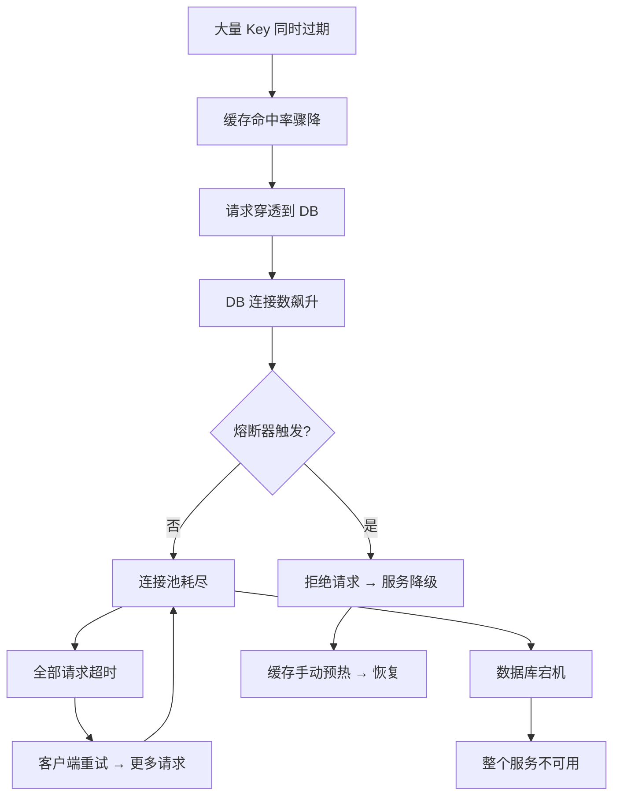
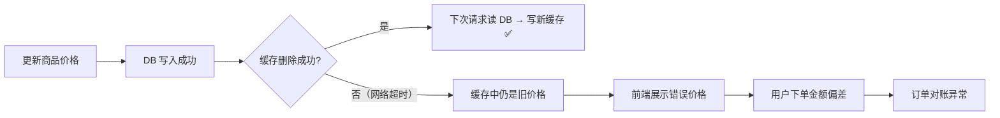
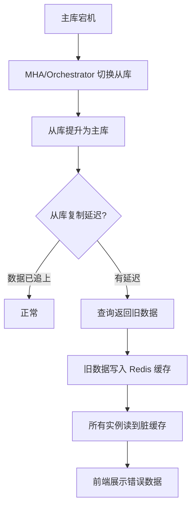
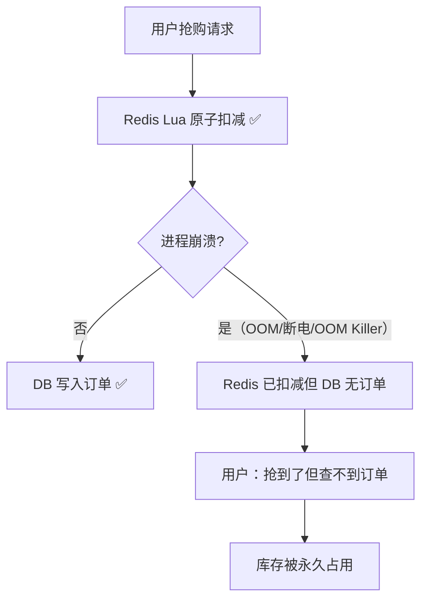

# 04 — 缓存+数据库连锁故障处置

> **难度**：⭐⭐⭐⭐ &emsp; **建议阅读时间**：60 分钟  
> **前置知识**：必须已阅读 [02-cache-design.md](./02-cache-design.md) 和 [03-database-design.md](./03-database-design.md)  
> **上一篇**：[03-database-design.md](./03-database-design.md)

---

## 📋 目录

- [4.1 四种连锁故障链详解](#41-四种连锁故障链详解)
- [4.2 关键止损点识别](#42-关键止损点识别)
- [4.3 秒杀系统三级防超卖](#43-秒杀系统三级防超卖)
- [4.4 秒杀崩溃恢复机制](#44-秒杀崩溃恢复机制)
- [4.5 幽灵用户检测](#45-幽灵用户检测)
- [4.6 售罄标记自愈](#46-售罄标记自愈)
- [4.7 多层流量控制协同](#47-多层流量控制协同)
- [4.8 应急响应总表](#48-应急响应总表)

---

## 4.1 四种连锁故障链详解

连锁故障（Cascading Failure）是指一个组件的故障引发下游组件故障，进而触发更广泛的系统崩溃。理解故障链的传播路径，是设计高可用系统的核心能力。

### 故障链一：缓存雪崩 → 数据库压垮

这是最常见的连锁故障模式，触发链路如下：



**故障传播时间线**：

| 阶段 | 时间 | 现象 | 关键信号 |
|------|------|------|---------|
| T+0s | Key 同时过期 | 缓存命中率从 95% 骤降至 5% | Redis 内存中大量 Key 消失 |
| T+1s | DB 连接数飙升 | 正常 10 个连接 → 瞬间 45+ | `Threads_connected` 跳变 |
| T+3s | 慢查询堆积 | P50 从 5ms → 500ms | GORM Logger Warn 刷屏 |
| T+5s | 熔断器触发 | `breaker.Allow()` 返回 false | 大量 `CodeServerError: 服务暂时不可用` |
| T+10s | 半开试探 | 单个请求通过 → 成功则恢复 | 熔断状态变为 HALF-OPEN |

**本项目的防护措施**（自底向上）：

| 防护层 | 位置 | 作用 |
|--------|------|------|
| TTL 随机抖动 ±20% | [product_cache.go](../internal/repository/redis/product_cache.go#L39-L47) | 事前：将集中过期分散到时间窗口 |
| 熔断器 | [circuit_breaker.go](../internal/pkg/breaker/circuit_breaker.go) | 事中：5 次连续错误 → OPEN，阻断流量 |
| 信号量限流 | [semaphore/limiter.go](../internal/pkg/semaphore/limiter.go) | 事中：限制 DB 并发 ≤30 |
| 缓存降级放行 | [product_cache.go](../internal/repository/redis/product_cache.go#L89-L95) | Recovery：Redis 故障不阻塞业务 |

若所有防护层逐一失效的顺序：

```text
TTL 抖动失效（所有 Key 用了相同 TTL）
    → 熔断器失效（maxErrors 设太大 或 RecordSuccess 误调用）
        → 信号量失效（timeout 设太短，降级请求在排队时也超时）
            → 最终防线：手动重启服务 + 扩容 DB
```

---

### 故障链二：数据不一致 → 业务异常



**脏数据扩散路径**：

```text
单品缓存脏（product:item:42）
    ↓ 列表缓存通过 SCAN 清理（product:list:*）
    ↓ 若 SCAN 清理也失败
列表缓存脏（product:list:手机:3）
    ↓ 秒杀活动引用了该商品
秒杀活动缓存脏
```

**自愈机制**：所有缓存都有 TTL 上限（单品 ≤1h、列表 ≤10min、空值 1min），即使全链路清理失败，TTL 过期后自动恢复。这是"最终一致性"的兜底保障。

---

### 故障链三：主库宕机 → 脏缓存扩散



**防护措施**：

| 措施 | 实现 |
|------|------|
| 主从切换期间禁止写缓存 | 依赖 Redis 连接超时（DialTimeout 5s）快速感知故障 |
| 缓存 TTL 兜底 | 脏缓存最晚 1 小时过期 |
| 连接池快速失败 | [redis.go](../internal/repository/redis/redis.go) ReadTimeout 3s / WriteTimeout 3s |
| 缓存降级放行 | Redis 故障时 Service 直接查 DB（跳过 Redis） |

---

### 故障链四：秒杀崩溃 → 订单丢失

这是**本项目特有**的故障模式，源于秒杀的两阶段提交特性（先 Redis Lua 扣库存，后 DB 写订单）：



**本项目通过 Pending 防丢失记录 + GuardConsistency 一致性守护器解决此问题**（详见 [§4.4](#44-秒杀崩溃恢复机制)）。

---

## 4.2 关键止损点识别

在故障传播路径中识别并加固止损点，是防止局部故障升级为全局灾难的关键。

```text
用户请求
    │
    ▼
┌──────────────┐
│ 止损点1：布隆过滤器   │ 拦截不存在的数据 → 阻止穿透流量
│ bloom.MightContain    │ 100% 拦截不存在的 ID
└──────────┬───────────┘
           │
┌──────────▼───────────┐
│ 止损点2：空值缓存      │ 拦截布隆误判 → 阻止穿透剩余流量
│ "nil" 标记 1分钟 TTL  │ 约 99% 的误判在此被拦截
└──────────┬───────────┘
           │
┌──────────▼───────────┐
│ 止损点3：分布式互斥锁   │ 限制回源并发为 1
│ SETNX + WaitAndRetry  │ 防止击穿流量放大
└──────────┬───────────┘
           │
┌──────────▼───────────┐
│ 止损点4：熔断器        │ 阻断 DB 异常调用
│ 5次连续错误 → OPEN     │ 雪崩时保住剩下的连接
└──────────┬───────────┘
           │
┌──────────▼───────────┐
│ 止损点5：信号量        │ 限制 DB 并发连接数
│ 30 slot channel       │ 连接池的 60%
└──────────────────────┘
```

### 止损有效性监控

| 止损点 | 监控指标 | 健康值 | 告警阈值 |
|--------|---------|--------|---------|
| 布隆过滤器 | 拦截率 | 拦截 >99% 不存在 ID | 拦截率 <90% |
| 空值缓存 | 命中率 | 缓存命中率 >20% | <5%（穿透激增） |
| 分布式互斥锁 | 锁等待超时率 | <1% | >5% |
| 熔断器 | 状态 | CLOSED | OPEN / 频繁 HALF-OPEN |
| 信号量 | 槽位占用率 | <80% | >95%（接近耗尽） |

---

## 4.3 秒杀系统三级防超卖

秒杀系统的核心挑战：**上千并发请求在毫秒级窗口内争抢有限库存，如何保证不超卖？**

本项目采用三级纵深防御：

```text
                    ┌─────────────────────┐
第1级（~30ns）       │   本地内存售罄检查     │
                    │   sync.Map + atomic  │
                    │   零网络开销           │
                    └──────────┬──────────┘
                               │ 未售罄
                    ┌──────────▼──────────┐
第2级（~0.5ms）      │   Redis Lua 原子扣减  │
                    │   库存检查+去重+扣减   │
                    │   单线程原子性保证     │
                    └──────────┬──────────┘
                               │ 扣减成功
                    ┌──────────▼──────────┐
第3级（~5ms）        │   DB 唯一约束兜底     │
                    │   user+product 唯一   │
                    │   索引防重复下单      │
                    └─────────────────────┘
```

### 第 1 级：本地内存售罄检查

[`internal/pkg/flashinventory/inventory.go`](../internal/pkg/flashinventory/inventory.go) — 使用 `sync.Map` + `atomic.Int32` + `atomic.Bool`：

```go
type Inventory struct {
    stocks   sync.Map     // flashSaleID → *atomic.Int32
    soldOuts sync.Map     // flashSaleID → *atomic.Bool
}

// 纯内存操作，~30ns，比 Redis 快 10000 倍
func (inv *Inventory) IsSoldOut(flashSaleID uint) bool {
    if v, ok := inv.soldOuts.Load(flashSaleID); ok {
        return v.(*atomic.Bool).Load()
    }
    return false
}
```

**为什么需要这一级？** 售罄后的请求在 Redis 层也会被拦截，但每次 Redis 调用都要 ~0.5ms 网络延迟。本地内存检查可以将售罄后的无效请求在进程内终结，大幅减轻 Redis 压力。

### 第 2 级：Redis Lua 原子扣减

[`internal/repository/redis/flash_cache.go`](../internal/repository/redis/flash_cache.go#L75-L103) 的 Lua 脚本：

```lua
-- KEYS[1] = flash:stock:N（库存计数器）
-- KEYS[2] = flash:user:N（已购用户集合）
-- KEYS[3] = flash:deduct_track:N（短期追踪列表）

local stock = redis.call('GET', KEYS[1])
if stock == false then return {3, 0} end  -- 未预热
if tonumber(stock) <= 0 then return {1, 0} end  -- 售罄

if redis.call('SISMEMBER', KEYS[2], ARGV[1]) == 1 then
    return {2, 0}  -- 已买过（去重）
end

redis.call('DECR', KEYS[1])     -- 扣库存
redis.call('SADD', KEYS[2], ARGV[1])  -- 记录买家
redis.call('RPUSH', KEYS[3], ARGV[1]) -- 短期追踪（TTL 5min）

return {0, stock - 1}  -- 成功
```

**Lua 脚本的原子性优势**：Redis 单线程执行 Lua 脚本，`GET → 判断 → DECR → SADD → RPUSH` 五步操作在脚本执行期间不会被其他命令打断，实现了"检查-操作"的原子性。

**返回码语义**：

| Code | 含义 | 处理 |
|------|------|------|
| 0 | 扣减成功 | 继续 → 写 pending → 写 DB |
| 1 | 库存不足 | 设置售罄标记（Redis + 本地内存） |
| 2 | 已购买（去重命中） | 返回"已参与过" |
| 3 | 活动未预热 | 返回系统错误 |

### 第 3 级：DB 唯一约束兜底

即使前两级全部失效（极端情况如 Lua 脚本被修改引入了 bug），数据库层还有最后一道防线：

- `order_items` 表有 `uniqueIndex` 约束：同一用户对同一秒杀活动只能有一条订单项
- 如果重复插入，MySQL 返回 `Duplicate entry` 错误
- Service 层捕获该错误后不执行 Redis 回滚（因为 Redis 扣减是合法的），直接返回"已参与过"

[`internal/service/flash/flash_service.go`](../internal/service/flash/flash_service.go#L603-L607)：

```go
if strings.Contains(err.Error(), "Duplicate") {
    // DB约束已拦截 — 不回滚Redis，不丢失已扣库存
    return &response.FlashSnatchResponse{Success: false, Message: "您已参与过该秒杀"}, nil
}
```

### 完整抢购流程

```text
SnatchFlashSale(userID, flashSaleID)
│
├─ ① per-user 限流（flashlimiter.Allow）
│     └─ 拒绝 → "操作过于频繁"
│
├─ ② 验证码校验（一次性消费）
│     └─ 失败 → "验证码错误/过期"
│
├─ ③ 活动有效性验证（时间窗口、状态）
│     └─ 失败 → 相应错误码
│
├─ ④ 入场资格校验
│     └─ 未入场 → "请先排队入场"
│
├─ ⑤ Redis 售罄标记检查（1次 GET）
│     └─ 售罄 → 直接返回
│
├─ ⑥ 本地内存售罄检查（~30ns）
│     └─ 售罄 → 直接返回
│
├─ ⑦ Redis Lua 原子扣减
│     ├─ code=0 → 成功，继续
│     ├─ code=1 → 设售罄标记 → 返回
│     ├─ code=2 → 返回"已参与过"
│     └─ code=3 → 返回"未预热"
│
├─ ⑧ 生成订单号 + 写 Pending 防丢失记录
│
├─ ⑨ 同步写 DB（事务）
│     ├─ 成功 → 清理 Pending → 返回成功
│     ├─ Duplicate → 不回滚 Redis → 返回
│     └─ 其他失败 → RollbackDeduct(Lua) → 清理 Pending
│
└─ ⑩ 返回结果
```

---

## 4.4 秒杀崩溃恢复机制

### 问题场景

秒杀使用"先 Redis 后 DB"的两阶段模式：

```text
Redis Lua 扣减成功 ✅  →  进程崩溃 💥  →  DB 订单未写入 ❌
```

结果：库存已扣减（Redis 中 `stock-1`），但用户查不到订单。这笔库存永久丢失。

### 三层恢复体系

```text
┌─────────────────────────────────────────────────┐
│  1. Pending 防丢失记录（写入窗口 < 1ms）            │
│     Redis Lua 扣减成功 → 立即 HSET pending        │
│     崩溃窗口：Lua 返回 ↔ SetPendingOrder 之间      │
└─────────────────────┬───────────────────────────┘
                      │
┌─────────────────────▼───────────────────────────┐
│  2. Deduct Track 列表（短期恢复窗口 5min）          │
│     Lua 脚本内部 RPUSH → TTL 5min                │
│     覆盖 SetPendingOrder 前崩溃的场景              │
└─────────────────────┬───────────────────────────┘
                      │
┌─────────────────────▼───────────────────────────┐
│  3. GuardConsistency 一致性守护（每 5 秒执行）      │
│     扫描 pending → 扫描 deduct_track → 库存对账    │
└─────────────────────────────────────────────────┘
```

### Pending 防丢失记录

[`internal/repository/redis/flash_cache.go`](../internal/repository/redis/flash_cache.go) 使用 Redis Hash 存储：

```
Key:   flash:pending:{flashSaleID}
Field: {userID}
Value: "{orderNo}|confirmed"  或  "{orderNo}|rolled_back"
```

```go
// SetPendingOrder — 在 DB 写入前调用，缩崩溃窗口
func (c *flashCache) SetPendingOrder(flashSaleID uint, userID uint, orderNo string) error {
    key := fmt.Sprintf("flash:pending:%d", flashSaleID)
    value := fmt.Sprintf("%s|confirmed", orderNo)  // "confirmed" 标记待处理
    return c.client.HSet(c.ctx, key, fmt.Sprintf("%d", userID), value).Err()
}
```

**生命周期**：

```text
SetPendingOrder("confirmed")
    │
    ├── DB 写入成功 → RemovePendingOrder（正常清理）
    │
    ├── DB 写入失败 → RollbackDeduct 成功 → MarkPendingRolledBack → Remove
    │
    └── DB 写入失败 → RollbackDeduct 失败 → 保留 pending → 等待 RecoverPendingOrders
```

### RecoverPendingOrders 两阶段恢复

[`internal/service/flash/flash_service.go`](../internal/service/flash/flash_service.go#L940-L1055) 在服务启动时和每 5 秒执行一次：

**阶段一：扫描 Pending 记录**

```text
SCAN flash:pending:*
    │
    对每条记录：
    ├── status == "rolled_back" → 直接清理（已回滚，不重建）
    ├── DB 中已有此订单 → 清理 pending
    ├── DB 中无此订单 → 补建订单 + 补扣库存
    └── 活动不存在 → 回滚 Redis + 清理 pending
```

**阶段二：扫描 Deduct Track 列表**

```text
对于每个活跃活动：
    │
    LRANGE flash:deduct_track:{id} 0 -1
    │
    对每个 userID：
    ├── Pending 中有记录 → 由阶段一处理
    ├── DB 中已有订单 → 跳过
    └── 以上皆无（场景A：SetPendingOrder 前崩溃）
        → 补建订单（Redis 已扣减，直接复用）
```

### 库存对账（ReconcileStock）

[`internal/service/flash/flash_service.go`](../internal/service/flash/flash_service.go#L1072-L1155) 比较 Redis 侧已售数量和 DB 侧已售数量：

```text
redisSold = 原始库存 - Redis 剩余
dbSold    = COUNT(orders WHERE flash_sale_id=X AND status IN(0,1,3))

偏差 = redisSold - dbSold

偏差 > 0（Redis 多扣）：
    ├─ 有 Pending 记录 → 等待 RecoverPendingOrders 补偿
    └─ 无 Pending → 用 CAS 修正 Redis 库存 = 原始库存 - dbSold

偏差 < 0（DB 多记录）：
    → 用 CAS 修正 Redis 库存 = 原始库存 - dbSold

偏差 = 0 → ✅ 一致
```

**为什么用 CAS 修正而不用直接 SET？** 对账修正和用户抢购可能并发。直接 `SET` 可能覆盖并发抢购的 `DECR` 结果。`AtomicSetStock` 使用 Lua 脚本的 CAS 模式：

```lua
-- 仅当 current == expected 时才设置，否则返回冲突
if current == expected then
    redis.call('SET', stock_key, new_val)
    return {1, new_val}
else
    return {0, current}  -- 有并发操作，放弃本轮修正
end
```

---

## 4.5 幽灵用户检测

### 问题

用户在某个时刻被加入 Redis 已购集合（SADD），但后续流程异常（DB 写入失败 + 回滚也失败），导致该用户在 Redis 中有记录但在 DB 中无订单。该用户再次尝试抢购时，Lua 脚本的 `SISMEMBER` 检查会拦截，形成**死锁**——既没有订单，也无法重新抢购。

### 检测与清理

[`internal/service/flash/flash_service.go`](../internal/service/flash/flash_service.go#L889-L917) 的 `purgeGhostPurchasers` 每 5 秒执行一次：

```text
对每个活跃活动：
    │
    从已购集合随机抽取 20 个用户（SRANDMEMBER）
    │
    对每个用户：
    ├── DB 中有有效订单 → 正常用户，保留
    └── DB 中无有效订单 → 👻 幽灵用户！
        → RollbackDeduct（回滚 Redis 已购资格）
```

**为什么是抽样而非全量？** 热门秒杀活动可能有数十万已购用户，全量扫描代价太高。抽样 20 个在性能和安全之间取得平衡——最坏情况下幽灵用户需要多轮抽样才能被清理（最多 5 秒 × N 轮）。

---

## 4.6 售罄标记自愈

### 问题

售罄标记存在两个副本——Redis 全局标记（多实例共享）和本地内存标记（纯内存优化）。两种场景可能导致标记错误：

1. **库存释放后标记未清**：用户取消订单释放库存 → Redis `stock+1` → 但如果 DeleteSoldOut 调用失败，标记仍然存在
2. **误设标记**：并发竞争导致库存未到 0 但标记被设置

### 自愈逻辑

[`internal/service/flash/flash_service.go`](../internal/service/flash/flash_service.go#L919-L938) 的 `healSoldOutFlag` 每 5 秒执行一次：

```text
对每个活跃活动：
    │
    读取 Redis 剩余库存
    │
    if 剩余 > 0 且 售罄标记 == true：
        → DeleteFlashSoldOut（Redis 标记）
        → ResetSoldOut（本地内存标记）
        → 日志："🩹 售罄标记自愈"
```

此外，库存对账中也有本地售罄标记的自愈（[`flash_service.go` L1096-L1099](../internal/service/flash/flash_service.go#L1096-L1099)）：

```go
// Redis 还有货但本地内存误标售罄 → 重置
if redisRemaining > 0 && s.inventory.IsSoldOut(f.ID) {
    s.inventory.ResetSoldOut(f.ID)
}
```

---

## 4.7 多层流量控制协同

本项目在四个层面实现了流量控制，各层独立但有协同兜底：

```text
          用户请求
              │
┌─────────────▼─────────────────────────────┐
│  入口层：IP 令牌桶限流                       │
│  [middleware/ratelimit.go]                 │
│  200 令牌/秒，burst 300                    │
│  兜底：防刷、防 DDoS                        │
└─────────────┬─────────────────────────────┘
              │
┌─────────────▼─────────────────────────────┐
│  业务层：Per-User 令牌桶限流                 │
│  [pkg/flashlimiter/limiter.go]             │
│  1 令牌/秒，burst 1                        │
│  兜底：防单人脚本抢购                        │
└─────────────┬─────────────────────────────┘
              │
┌─────────────▼─────────────────────────────┐
│  数据库层：信号量限流                        │
│  [pkg/semaphore/limiter.go]               │
│  30 并发槽位，2s 超时                       │
│  兜底：保护 DB 连接池                       │
└─────────────┬─────────────────────────────┘
              │
┌─────────────▼─────────────────────────────┐
│  异常检测层：熔断器                          │
│  [pkg/breaker/circuit_breaker.go]          │
│  5 次连续错误 → OPEN，30s 试探              │
│  兜底：防止故障扩散                          │
└───────────────────────────────────────────┘
```

### 协同效果矩阵

| 场景 | IP 限流 | Per-User 限流 | 信号量 | 熔断器 | 结果 |
|------|---------|--------------|--------|--------|------|
| 正常流量 | 放行 | 放行 | 放行 | CLOSED | ✅ |
| 单人脚本刷接口 | 放行（IP 维度不超） | **限流（1次/秒）** | 放行 | CLOSED | ✅ 拦截 |
| DDoS 攻击 | **限流（200次/秒/IP）** | — | — | — | ✅ 拦截 |
| 缓存雪崩 | 放行 | 放行 | **排队（30并发）** | **OPEN（阻断）** | ✅ 保护 |
| 熔断器失效 | 放行 | 放行 | **排队（30并发）** | 失效 | ⚠️ 降级保护 |
| 信号量失效 | 放行 | 放行 | 失效 | **OPEN（阻断）** | ⚠️ 降级保护 |

关键设计原则：**没有单点依赖**。每一层都有下一层兜底；每一层失效时，下一层仍然能提供部分保护。

---

## 4.8 应急响应总表

### 故障分级与响应

| 编号 | 故障名称 | 严重级别 | 影响范围 | 响应时间 | 关键止损操作 | RTO | 涉及组件 |
|------|---------|---------|---------|---------|------------|-----|---------|
| F1 | 缓存雪崩 → DB 挂 | 🔴 P0-紧急 | 全部用户 | 立即 | ①确认熔断器已触发 ②手动预热缓存 ③临时扩容 DB 连接池 ④启用只读降级 | <5min | Redis/MySQL/Breaker |
| F2 | 主库宕机 → 脏缓存 | 🔴 P0-紧急 | 全部写入 | 立即 | ①触发主从切换 ②禁止写缓存 ③清理受影响缓存 Key | <10min | MySQL/Redis |
| F3 | 数据不一致 → 业务异常 | 🟠 P1-高 | 部分用户 | 15min 内 | ①手动删除受影响缓存 ②检查 SCAN 清理是否完整 ③必要时全量重建 | <15min | Redis/MySQL |
| F4 | 秒杀崩溃丢单 | 🟠 P1-高 | 崩溃窗口期用户 | 5min 内 | ①等待 RecoverPendingOrders 自动恢复（5s 周期）②手动触发恢复 ③检查 Pending 记录 | <5min | Redis/MySQL/Flash |
| F5 | 幽灵用户 | 🟡 P2-中 | 少量用户 | 1h 内 | 自动检测+自动清理（已内置 5s 周期） | 自动 | Redis/MySQL |
| F6 | 售罄标记异常 | 🟡 P2-中 | 特定活动 | 1h 内 | 自动自愈（已内置 5s 周期） | 自动 | flash_cache.go |
| F7 | 数据库连接池耗尽 | 🟠 P1-高 | 全部用户 | 15min 内 | ①定位慢 SQL（GORM Logger）②KILL 长事务 ③临时增大 MaxOpenConns | <15min | MySQL/Semaphore |
| F8 | Redis 节点宕机 | 🟡 P2-中 | 延迟增加 | 30min 内 | ①确认降级逻辑生效 ②切换 Sentinel ③预热恢复后缓存 | <30min | Redis/MySQL |

### 紧急操作手册

**场景 F1：缓存雪崩应急**

```bash
# 1. 确认熔断器状态（查看日志）
grep "熔断" logs/app.log

# 2. 手动预热热门商品（调用内部接口或重启服务）
curl -X POST http://localhost:8080/api/v1/admin/flash/{id}/warmup

# 3. 临时扩容（如果 DB 是瓶颈）
# 修改 docker-compose.yml 或 K8s 配置，增加 MySQL 连接数

# 4. 监控恢复
watch -n 1 'curl -s http://localhost:8080/health'
```

**场景 F4：秒杀崩溃丢单**

```bash
# 1. 查看 pending 记录数量
redis-cli SCAN 0 MATCH "flash:pending:*" COUNT 100

# 2. 手动触发恢复（重启服务自动执行 RecoverPendingOrders）

# 3. 检查恢复日志
grep "RecoverPendingOrders\|补建订单" logs/app.log

# 4. 验证库存一致性
# 对比 Redis 库存和 DB 已售数量
```

**场景 F7：连接池耗尽**

```sql
-- 1. 查看当前连接
SHOW PROCESSLIST;

-- 2. 找慢查询（Time 列大的）
SELECT * FROM information_schema.processlist WHERE command != 'Sleep' ORDER BY time DESC;

-- 3. 杀死长时间运行的查询
KILL <id>;

-- 4. 查看连接数变化
SHOW STATUS LIKE 'Threads_connected';
```

### 日常巡检清单

| 检查项 | 频率 | 命令/方法 | 预期结果 |
|--------|------|----------|---------|
| 熔断器状态 | 每 5 分钟 | 日志中搜索 `breaker` | 状态为 CLOSED |
| 缓存命中率 | 每小时 | Redis `INFO stats` | keyspace_hits / (hits+misses) > 90% |
| DB 连接数 | 每小时 | `SHOW STATUS LIKE 'Threads_connected'` | < 40 |
| 慢查询数量 | 每小时 | `grep "慢查询" logs/app.log` | < 10 条/小时 |
| Pending 记录 | 每天 | `redis-cli SCAN 0 MATCH "flash:pending:*"` | 0（正常运行时应为空） |
| 幽灵用户 | 每天 | 日志中搜索 `👻` | 0 |
| 对账偏差 | 每天 | 日志中搜索 `对账异常` | 0 |

---

> **全文完** — 感谢阅读。这四份文档覆盖了本项目从架构设计到故障处理的全链路知识。建议结合项目源码（[`internal/`](../internal/)）对照阅读，加深理解。如有疑问，欢迎提交 Issue。
